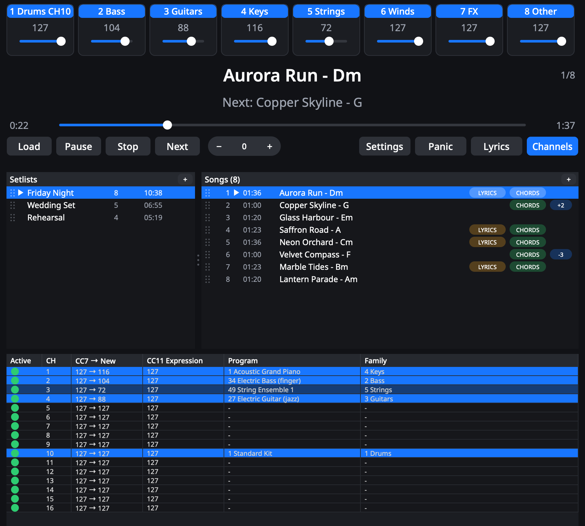
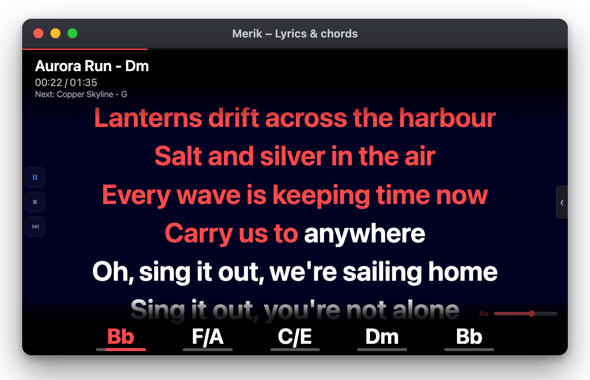
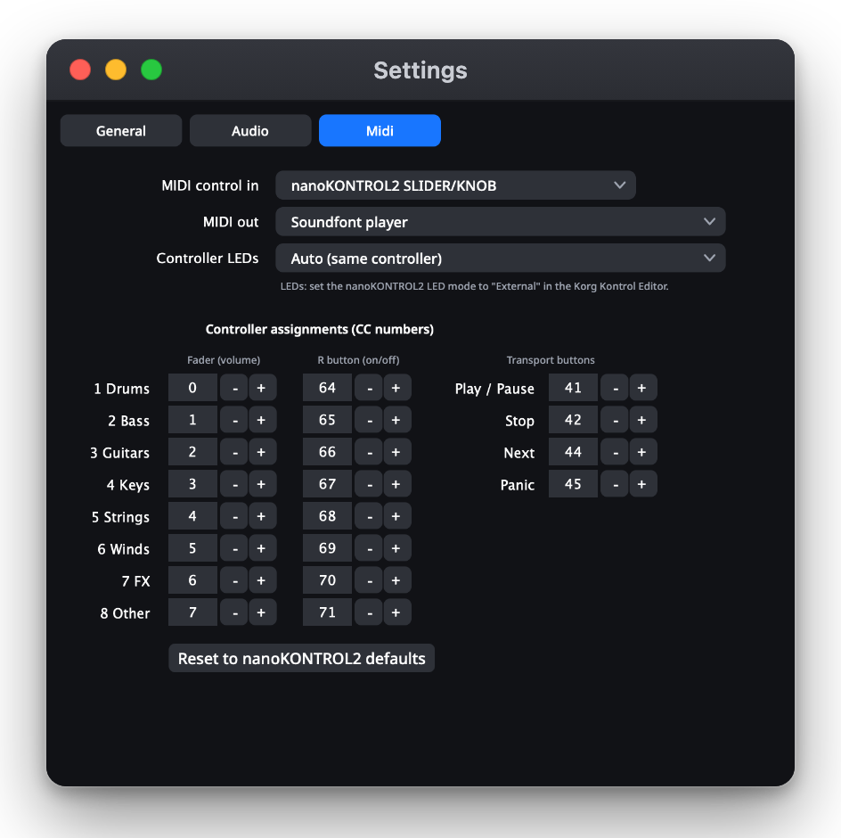
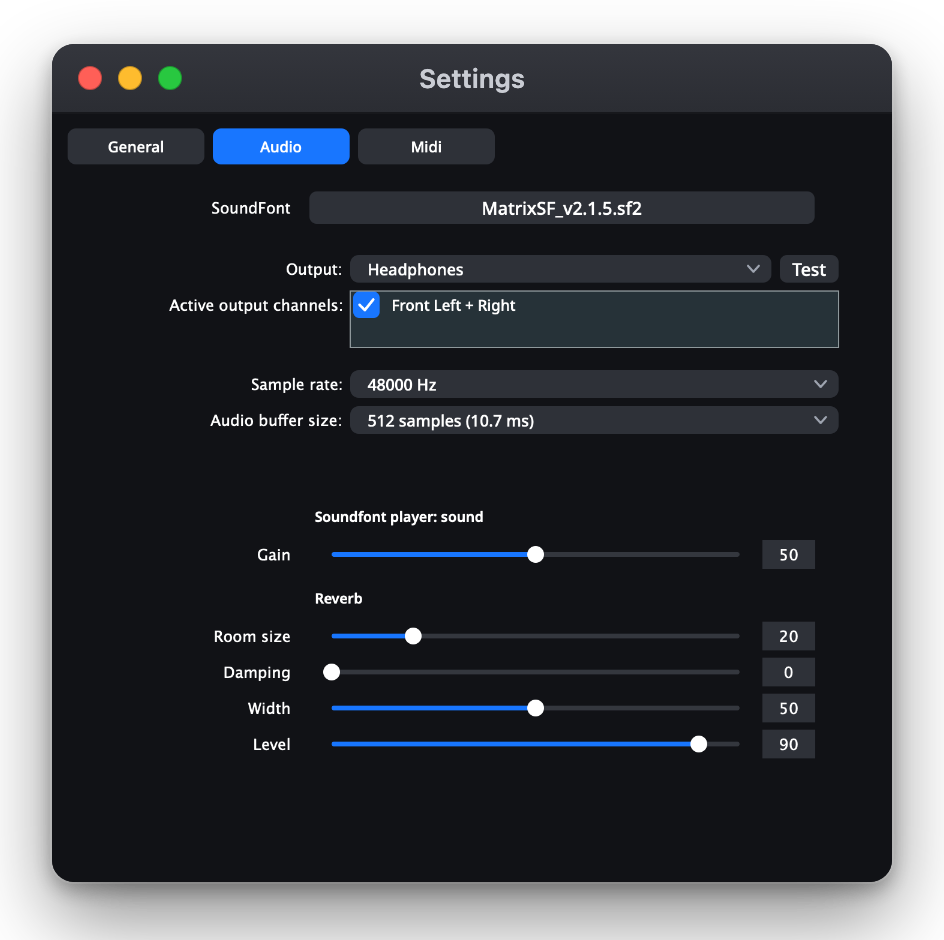

# Merik

**The live MIDI player built for the stage.**
Play your MIDI backing tracks through a SoundFont or your own sound modules, mix them on the fly, and keep every singer and player in the band in sync with lyrics and chords on any phone, tablet or laptop.

<p align="center">
  
</p>

Merik turns a folder of standard MIDI files into a gig-ready system: setlists, a live mixer, hardware control, and a lyrics-and-chords display that your band can open in a web browser. No cloud, no account, no latency from the internet. Everything runs on one machine on your own network.

---

## Download

**[Download Merik 0.1.0-alpha.1 for macOS](https://github.com/erik-nie/Merik2/releases/tag/v0.1.0-alpha.1)** (Apple silicon, macOS 27.0 or later). This is an early alpha: expect rough edges. All releases are listed on the [releases page](https://github.com/erik-nie/Merik2/releases).

**Install**

1. Download `Merik-0.1.0-alpha.1-arm64.dmg` from the release page, open it and drag **Merik** to **Applications**.
2. This build is **not notarized**, so macOS blocks the first start. Right-click **Merik.app**, choose **Open** and confirm. If it is still blocked, run this in Terminal:
   ```sh
   xattr -dr com.apple.quarantine /Applications/Merik.app
   ```
3. Choose a General MIDI SoundFont (`.sf2`) under **Settings → Audio**. Merik does not include one. `MatrixSF_v2.1.5.sf2` is a great free option, but many others exist.

Prefer to build it yourself? See [Building from source](#building-from-source).

---

## Why Merik

- **Made for performing.** Big, readable controls, instant song changes, a hardware-friendly workflow and a panic button that really silences everything.
- **Everyone sees the song.** Karaoke-style lyrics and a chord strip with slash chords and bass notes, in any browser on the same Wi-Fi.
- **Your sound, your gear.** Use the built-in SoundFont player, or send the music to hardware MIDI modules and software players with tight, hardware-style timing.
- **Fast to set up.** Drop in your MIDI files, drag them into setlists, press play.

---

## Features

### Playback and mixing
- **Built-in SoundFont player** powered by FluidSynth, with 256-voice polyphony and adjustable gain and reverb.
- **Eight instrument families** with a fader and an on/off switch each: balance the whole band with eight controls instead of sixteen channels. See [How the family mixer works](#how-the-family-mixer-works).
- **Per-channel switches** to mute a channel for one song or for the whole evening.
- **Normalize to the drum channel** so tracks from different sources sit at a similar level.
- **Transpose** by up to an octave in either direction, live. Drums are left alone and the chords follow along. Each song can remember its own transpose.
- **Pause, resume, seek and stop** without hanging notes, plus a **Panic** button.
- **Auto-play next song** in the setlist, or keep full manual control.

### How the family mixer works

A MIDI file has up to 16 channels, each playing its own instrument, and every file lays them out differently. Instead of making you chase 16 channel faders, Merik **groups the channels by the kind of instrument** into eight *families*. Each family has one fader and one on/off switch, at the top of the main window.

**Channels join a family automatically.** Merik looks at the instrument (the General MIDI program) that each channel plays and puts the channel in the matching family. If a song changes instrument halfway, the channel moves with it. The table at the bottom of the main window shows, per channel, the instrument and the family it belongs to.

| Family | What goes in |
|---|---|
| **1 Drums** | MIDI channel 10, the percussion channel |
| **2 Bass** | Basses (GM programs 33–40) |
| **3 Guitars** | Guitars (25–32) |
| **4 Keys** | Pianos, chromatic percussion and organs (1–24), synth leads and pads (81–96), ethnic and percussive instruments (105–120) |
| **5 Strings** | Strings and string ensembles (41–56) |
| **6 Winds** | Brass, reeds and pipes (57–80) |
| **7 FX** | Synth effects (97–104) and sound effects (121–128) |
| **8 Other** | Reserved. Nothing is placed here automatically. |

**What the controls do**
- The **fader** (0–127) scales the volume of every channel in the family, live. The volume written in the file is the starting point, so a fader at 64 plays the family at about half of what the file says. This works for the built-in sound and for external MIDI devices alike.
- The **name button** above the fader (or the **R button** on a controller) switches the whole family on or off. A switched-off family keeps playing silently, so it comes back instantly and in time.
- In the channel table, the **Active** column fine-tunes a single channel: a click cycles *green* (on), *orange* (off for this song only, back on for the next song) and *red* (off until you change it).
- **Normalize** can level the channels against the drum channel, so files that were mixed differently start from a similar balance.

**Typical uses**
- Playing with a live drummer? Switch the Drums family off.
- A singer wants space? Pull the Winds or Keys fader down, or switch that family off for the song.
- A guitarist wants to play the solo? Mute just the guitar channel for this song with the orange state.

The same eight faders and switches are available on a MIDI controller such as the nanoKONTROL2 and, with the remote key, on the web page.

### Setlists that stay out of your way
- Any number of setlists, reorderable by drag and drop.
- Drag songs to reorder them, to move them to another setlist, or hold <kbd>Command</kbd> (<kbd>Ctrl</kbd> on Windows and Linux) to copy them. Select several songs at once.
- The same song can appear more than once.
- Right-click menus to rename (your own title, the file name is untouched), transpose, duplicate, copy, move, delete, or show a file in the Finder.
- Song length, setlist total time, and tags that show which songs have **lyrics** and which have **chords**. Missing files are flagged in red.
- Everything is remembered between sessions.

### Lyrics and chords
- Reads lyrics from standard MIDI files, including karaoke (KAR) and Midisoft files, with word-by-word highlighting and correct handling of accented characters.
- Finds chords in the places MIDI files actually hide them: **Yamaha XF** chord data, **Midisoft** chord lines, markers and text events. Slash chords and bass notes (such as F/A or C/E) are shown properly.
- Chords transpose together with the music.

### Remote display and control in your browser
- Open Merik's address on any phone, tablet or laptop on the same network and get a full-screen **lyrics and chord display** with a progress bar for the current chord, a countdown before the first line, and an adjustable text size.
- By default the page is **view only**, so the audience and the band can't change anything by accident.
- Add your secret key to the address and the same page also shows **Play / Pause, Stop, Next** and the **family mixer**.

<p align="center">
  
</p>

### Hardware: MIDI out, MIDI in and LEDs
- **MIDI out** to hardware modules, interfaces and virtual ports, or to the built-in SoundFont player. Each message is scheduled on the audio clock and handed to the system with its own timestamp, so fast runs and chords stay tight.
- **MIDI control in** for controllers such as the **Korg nanoKONTROL2**: faders set the family volumes, the R buttons switch families on and off, and the transport buttons play, stop, skip and panic.
- **Controller LEDs** show the state: Next and Stop lit, Play lit while playing and blinking while paused, R buttons lit while the family is on. (Set the nanoKONTROL2 LED mode to *External* in the Korg Kontrol Editor.)
- Every CC number can be changed in Settings.

<p align="center">
  
</p>

### Settings
- **General:** remote-control key and the playback options.
- **Audio:** SoundFont, output device, sample rate, buffer size, and the gain and reverb of the built-in sound.
- **Midi:** input, output, controller LEDs and all CC assignments.

<p align="center">
  
</p>

---

## Getting started

1. Start Merik and choose a General MIDI SoundFont (`.sf2`) under **Settings → Audio**.
2. Add your MIDI files with the **+** in the Songs header, or drag them onto the window.
3. Double-click a song to load it, then press **Play**.
4. For the lyrics display, press **Lyrics** in Merik, or open Merik's address (port 8888) on another device. **Settings → General** shows the full address.

You will need to bring your own SoundFont. Merik works with any General MIDI SoundFont in the `.sf2` format. `MatrixSF_v2.1.5.sf2` is a great free GM SoundFont to start with, but many others exist.

Want something to try first? The folder [`docs/demo`](docs/demo) has four small demo songs with invented lyrics and chords.

### Remote control

In **Settings → General** you can set a key. Then:

- `http://<address>:8888/` shows lyrics and chords (view only).
- `http://<address>:8888/?key=<your key>` also shows the transport buttons and the mixer.

Leave the key empty to make the web page strictly view-only. The key travels over your local network without encryption, so use this on a network you trust, not on the open internet.

---

## Building from source

Merik is written in C++20 with [JUCE](https://juce.com) for the interface and audio, [FluidSynth](https://www.fluidsynth.org) for the sound and [midifile](https://github.com/craigsapp/midifile) for reading MIDI files (included in `src/midifile`).

**macOS** (developed and tested on Apple silicon):

```sh
# Tools and the FluidSynth library
brew install cmake pkg-config fluid-synth

# Configure and build (JUCE is downloaded automatically the first time)
cmake -S . -B build -DCMAKE_BUILD_TYPE=Release
cmake --build build -j

# Run
open build/Merik_artefacts/Merik.app
```

**Linux** (not yet tested):

```sh
sudo apt install build-essential cmake pkg-config libfluidsynth-dev \
    libasound2-dev libfreetype-dev libfontconfig1-dev libx11-dev libxrandr-dev \
    libxinerama-dev libxcursor-dev libgl1-mesa-dev
cmake -S . -B build -DCMAKE_BUILD_TYPE=Release
cmake --build build -j
```

Requirements: a C++20 compiler, CMake 3.22 or newer, FluidSynth 2.2 or newer (found through `pkg-config`) and an internet connection for the first configure (it fetches JUCE).

Windows is not supported yet, because the remote-control server uses POSIX sockets.

### Releases

`scripts/make-release.sh` builds a macOS (Apple silicon) release, bundles FluidSynth and its libraries into the app, signs it and packs a DMG in `dist/`. It needs `dylibbundler` (`brew install dylibbundler`).

```sh
scripts/make-release.sh 0.1.0-alpha.1
```

Without further settings the app is signed ad hoc. For a Developer ID signature and notarization, set `SIGN_IDENTITY` and `NOTARY_PROFILE` (see the comments in the script). The release runs on the macOS version it was built on or newer, because the bundled libraries are built for that version; the script prints it.

### Project layout

| Folder | Contents |
|---|---|
| `src/` | Application, playback engine, parsers, web server |
| `include/` | Headers |
| `src/midifile/` | MIDI file library |
| `assets/` | Fonts and the application icon |
| `docs/` | Screenshots and demo songs |

---

## Support Merik

Merik is free and developed in spare time. If it helps your band or your gigs, you can support its development on Ko-fi:

<p align="center">
  <a href="https://ko-fi.com/eriknie"></a>
</p>

---

## Credits

Merik uses [JUCE](https://juce.com), [FluidSynth](https://www.fluidsynth.org), [midifile](https://github.com/craigsapp/midifile) by Craig Stuart Sapp and the Noto Sans typeface. Their licenses apply to their respective parts, see [THIRD-PARTY-LICENSES.md](THIRD-PARTY-LICENSES.md).

## License

Merik is free software, licensed under the **GNU Affero General Public License v3.0**. See [LICENSE](LICENSE) and [THIRD-PARTY-LICENSES.md](THIRD-PARTY-LICENSES.md).

Copyright © Erik Nie.
