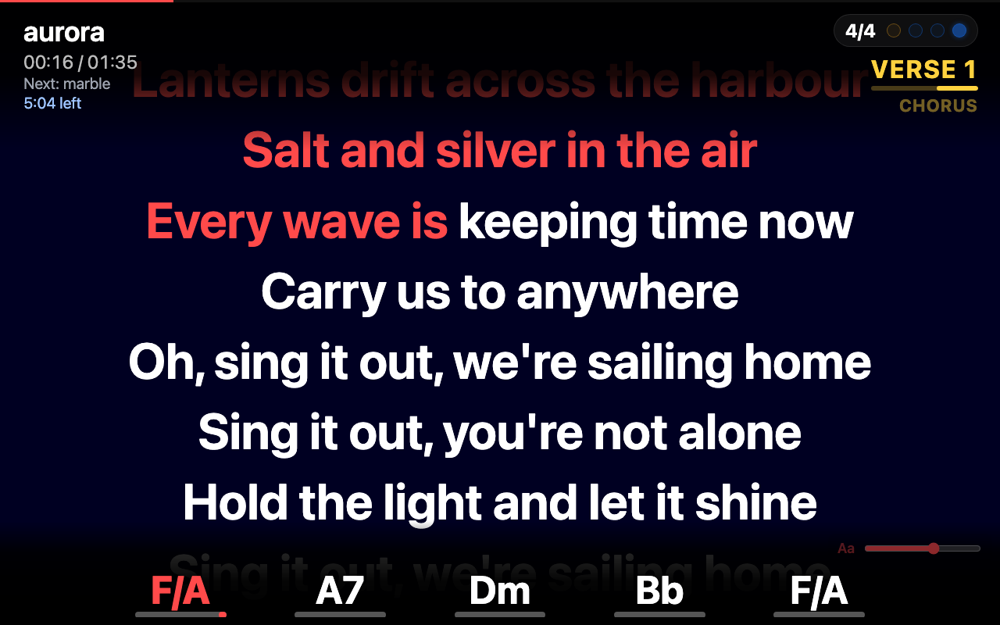

# Merik

[](https://github.com/erik-nie/Merik2/releases)
[](https://github.com/erik-nie/Merik2/releases)
[](LICENSE)
[](https://ko-fi.com/eriknie)

**The live MIDI player built for the stage.**
Play your MIDI backing tracks through a SoundFont or your own sound modules, mix them on the fly, and keep every singer and player in the band in sync with lyrics and chords on any phone, tablet or laptop.

<p align="center">
  
</p>

Merik turns a folder of standard MIDI files into a gig-ready system: setlists, a live mixer, hardware control, and a lyrics-and-chords display that your band can open in a web browser. No cloud, no account, no latency from the internet. Everything runs on one machine on your own network.

**New here?** The [help pages](docs/index.md) walk you through [playing MIDI files](docs/play-midi.md), [audio files](docs/play-audio.md) and [both together](docs/play-mixed.md), [the web page for the band](docs/web-page.md) and [rendering MIDI to audio](docs/render.md).

---

## Download

**[Download Merik 0.6.0](https://github.com/erik-nie/Merik2/releases/tag/v0.6.0)** for macOS or Windows. All releases are listed on the [releases page](https://github.com/erik-nie/Merik2/releases).

| System | File | Requirements |
|---|---|---|
| **macOS, Apple silicon** (M1 and newer) | `Merik-0.6.0-arm64.dmg` | macOS 14 or later |
| **macOS, Intel** | `Merik-0.6.0-intel.dmg` | Intel Mac, macOS 15 or later |
| **Windows** | `Merik-0.6.0-windows-x64.zip` | Windows 10 or 11, 64-bit |

**Install on macOS** (both versions)

1. Open the DMG and drag **Merik** onto **Applications**.
2. The app is **not notarized**, so macOS blocks the first start. Right-click **Merik.app**, choose **Open** and confirm. If it is still blocked, run this in Terminal:
   ```sh
   xattr -dr com.apple.quarantine /Applications/Merik.app
   ```

**Install on Windows**

1. Extract the zip to a folder and run `Merik.exe`.
2. The build is not code-signed, so SmartScreen may warn about an unknown app. Click **More info**, then **Run anyway**.
3. Allow Merik on private networks when Windows asks, to use the lyrics and remote control web page.

**First start (both systems):** choose a General MIDI SoundFont (`.sf2`) under **Settings → Soundfont**. Merik does not include one. `MatrixSF_v2.1.5.sf2` is a great free option, but many others exist.

Prefer to build it yourself? See [Building from source](#building-from-source).

---

## Support Merik

Merik is free and made in spare time. If it helps your band or your gigs, a coffee keeps the development going:

<p align="center">
  <a href="https://ko-fi.com/eriknie" target="_blank"></a>
</p>

---

## What makes Merik different

Plenty of players can play a MIDI file. Merik is built for the person who runs the whole band from one laptop:

- **One laptop, one cable.** Connect a laptop to an audio interface or straight to a digital mixer over USB, and the whole backing band comes from Merik, with the click on its own output for the drummer.
- **Everybody in the band sees the song.** Lyrics and chords appear in a browser on any iPad, Android tablet or phone, at `http://merik.local`, with the current section, a beat counter and a countdown before the next line. No app to install, nothing to configure on the tablets.
- **Almost every lyric and chord format.** Standard lyric events, karaoke (KAR) and Midisoft files, Yamaha XF chord data, Midisoft chords, markers and text events, with slash chords and bass notes. The lyrics and chords transpose with the music.
- **Sections from the MIDI file.** *Intro*, *Verse 2*, *Chorus*, *Solo*... shown as they come, including the `15@Refrain:` markers many karaoke files use.
- **Setlists you can steer while you play.** From the tablet, search the whole library, **play a song now or next**, or **jump** to another place in the setlist, without losing your place. Merik tells you how much time is left in the set.
- **MIDI, audio, or both.** Play MIDI through a SoundFont or a hardware module, play recorded stems, or mix them per instrument family: a live vocal track on a MIDI band, real drums with the rest in MIDI.
- **Render your own sound.** Turn MIDI files into audio stems with Merik's SoundFont, a plug-in in your favourite host or a hardware module, so that the sound you like is on the gig without the plug-ins.
- **Made for performing.** Big readable controls, instant song changes, a family mixer instead of sixteen channel faders, transpose and volume per song, hardware controllers with LEDs, and a panic button that really silences everything.
- **Free and local.** No cloud, no account, no subscription. Open source (AGPL).

---

## Features

### Playback and mixing
- **Built-in SoundFont player** powered by FluidSynth, with 256-voice polyphony and adjustable gain and reverb.
- **Eight families** (seven instrument families plus the click) with a fader and an on/off switch each: balance the whole band with eight controls instead of sixteen channels. See [How the family mixer works](#how-the-family-mixer-works).
- **Click track** generated from the tempo and time signature of the song, sample-accurate with the music. Send it to its own output (for example the drummer's in-ear mix) while the audience only hears the band. Volume and on/off live on family 8.
- **Audio stems** in a `.merik` file next to or instead of the MIDI parts: play a recorded band, mix MIDI and audio per family, or add a live vocal track. See [Audio stems (.merik)](#audio-stems-merik).
- **Per-channel switches** to mute a channel for one song or for the whole evening.
- **Normalize to the drum channel** so tracks from different sources sit at a similar level.
- **Transpose** by up to an octave in either direction, live. Drums are left alone and the chords follow along. Each song can remember its own transpose.
- **Pause, resume, seek and stop** without hanging notes, plus a **Panic** button.
- **Auto-play next song** in the setlist, or keep full manual control.

### How the family mixer works

A MIDI file has up to 16 channels, each playing its own instrument, and every file lays them out differently. Instead of making you chase 16 channel faders, Merik **groups the channels by the kind of instrument** into eight *families*. Each family has one fader and one on/off switch, at the top of the main window.

**Channels join a family automatically.** Merik looks at the instrument (the General MIDI program) that each channel plays and puts the channel in the matching family. If a song changes instrument halfway, the channel moves with it. The table at the bottom of the main window shows, per channel, the instrument and the family it belongs to.

| Family | What goes in |
|---|---|
| **1 Drums** | MIDI channel 10, the percussion channel |
| **2 Bass** | Basses (GM programs 33–40) |
| **3 Guitars** | Guitars (25–32) |
| **4 Keys** | Pianos, chromatic percussion and organs (1–24), synth leads and pads (81–96), ethnic and percussive instruments (105–120) |
| **5 Strings** | Strings and string ensembles (41–56) |
| **6 Winds** | Brass, reeds and pipes (57–80) |
| **7 Others** | Synth effects (97–104) and sound effects (121–128), and the place for extra audio stems such as a live vocal |
| **8 Click** | The click track: its fader is the click volume and its switch turns the click on or off. No MIDI channels are placed here. |

**What the controls do**
- The **fader** (0–127) scales the volume of every channel in the family, live. The volume written in the file is the starting point, so a fader at 64 plays the family at about half of what the file says. This works for the built-in sound and for external MIDI devices alike.
- The **name button** above the fader (or the **R button** on a controller) switches the whole family on or off. A switched-off family keeps playing silently, so it comes back instantly and in time.
- In the channel table, the **Active** column fine-tunes a single channel: a click cycles *green* (on), *orange* (off for this song only, back on for the next song) and *red* (off until you change it).
- **Normalize** can level the channels against the drum channel, so files that were mixed differently start from a similar balance.

**Typical uses**
- Playing with a live drummer? Switch the Drums family off.
- A singer wants space? Pull the Winds or Keys fader down, or switch that family off for the song.
- A guitarist wants to play the solo? Mute just the guitar channel for this song with the orange state.

The same eight faders and switches (the last one is the click) are available on a MIDI controller such as the nanoKONTROL2 and, with the remote key, on the web page.

### Audio stems (.merik)

A **.merik** file lets a song carry recorded audio next to (or instead of) the MIDI parts. It is a zip file in which Merik recognises everything by its **file name**; whatever is missing falls back to the MIDI file or to Merik's own click.

```
My Song.merik
├── song.mid          tempo, lyrics, chords and MIDI parts (optional)
├── 1-drums.flac      audio stems: <family number>-<name>.<wav|flac|mp3>
├── 2-bass.flac
├── 7-void.mp3        Others: a live vocal, a choir, backing vocals...
├── click.wav         your own click track (optional)
├── chords.json       chords (optional)
└── lyrics.json       lyrics (optional)
```

- **`number-name`:** the number (1–7, 8 = click) is the family, the name is shown on the family button (first 8 characters): `7-void.mp3` shows **7 void**.
- **Audio wins per family:** a family with a stem does not play its MIDI notes; families without a stem keep playing from the MIDI file. A missing `click.wav`, `chords.json` or `lyrics.json` falls back to the internal click and to what is in the MIDI file.
- **Keep the original order of the families.** If a bass player joins live, family 2 is switched off, so don't put backing vocals there. Extra tracks belong in **7 (Others)**.
- Each family can be sent to its **own output**, and the click to another (Settings → Audio). Each family button shows an **AUDIO** or **MIDI** pill with a level meter. Transpose is not available for songs with stems.
- Stems stored without compression are **streamed**: the song is ready in a fraction of a second and uses very little memory.

**Making a .merik:** in **Settings → Tools → Create a .merik file from a folder...** choose the folder with your stems. Merik shows what it recognised, warns about problems (different lengths, no MIDI or tempo), can convert WAV to FLAC without loss, saves the `.merik` the right way and can add it to your setlist. This is the recommended way.

There is a ready-made test song in [docs/demo/Stems Demo.merik](docs/demo/Stems%20Demo.merik). All details (priority table, JSON formats for chords, lyrics and tempo, and **making a `.merik` by hand** on macOS and Windows) are in [docs/merik-format.md](docs/merik-format.md).

### Rendering MIDI to audio

Merik turns MIDI files into `.merik` files with real audio stems, one family at a time, with four possible sound sources:

1. **Merik's own SoundFont**: no hardware needed, and much faster than real time.
2. **A standalone audio app** such as SoundCanvas.
3. **A plug-in in a host** (Logic, MainStage, Bidule), recorded through a virtual audio device such as BlackHole.
4. **A hardware synth or module** (SoundCanvas, Genos, Kentron, MU2000, TG100, ...), recorded through your audio interface.

For the recorded methods Merik measures the delay between sending MIDI and hearing the sound and stores it in the file, so MIDI and audio stay together; you set the level with an interactive test (target about -6 dB). A **demo render** (only the first 30 seconds of every track) is a quick way to try a sound source, and Merik asks before it overwrites an existing result. Rendering gives you separate outputs per family, is safer on stage than live plug-ins, and the result plays on any computer.

Settings → **Tools → Render MIDI files...**. The overview is in [docs/render.md](docs/render.md), the recording details in [docs/render-external-module.md](docs/render-external-module.md).

### Setlists that stay out of your way
- Any number of setlists, reorderable by drag and drop. Right-click on the empty space below the setlists for a new setlist.
- Drag songs to reorder them, to move them to another setlist, or hold <kbd>Command</kbd> (<kbd>Ctrl</kbd> on Windows and Linux) to copy them. Select several songs at once.
- The same song can appear more than once.
- **Volume per song** (a difference in dB, next to the transpose control or in the right-click menu): audio stems and the built-in SoundFont can go louder or softer; for an external MIDI device Merik adjusts the channel volumes (softer works fully, louder only where the file's own volume is below the maximum). It is remembered per song.
- **Time left:** the remaining time of the setlist (the rest of the current song plus the songs after it) is shown next to the position ("6/10  34:12 left") in the app and on the web page (there as "2:21:31 left", left aligned under the next song).
- **Search** (magnifier next to the song list, or Ctrl/Cmd+F): type 3 letters and pick from the candidates; search in the current setlist or in all setlists. Each result has **Play now** and **Play next** buttons. Choose **Play next** (shown as the next song; when the current one ends it starts by itself if *auto play next* is on, otherwise it is loaded and waits for Play) or **Play now**. An inserted song does not change where you are in your setlist: when it ends, or when you press Next, the setlist goes on where it was. The **Continue** button also takes you back to that setlist and position.
- Right-click menus to rename (your own title, the file name is untouched), transpose, duplicate, copy, move, delete, or show a file in the Finder.
- Song length, the **time left until the end of the setlist for every song** (this song included, so the first song shows the total), setlist total time, and tags that show which songs have **lyrics**, **chords**, **MIDI** and **audio**. Missing files are flagged in red.
- Everything is remembered between sessions.

### Lyrics and chords
- Reads lyrics from standard MIDI files, including karaoke (KAR) and Midisoft files, with word-by-word highlighting and correct handling of accented characters.
- Finds chords in the places MIDI files actually hide them: **Yamaha XF** chord data, **Midisoft** chord lines, markers and text events. Slash chords and bass notes (such as F/A or C/E) are shown properly.
- Chords transpose together with the music.
- **Section names** found in the MIDI file (Intro, Verse, Refrain, Solo, ... including the `15@Refrain:` style markers of many karaoke files) appear in yellow at the top right of the browser page, under the beat counter with its LEDs: the current section with a line that runs out (like the chords), and below it the next one, smaller and transparent. At a change the next section slides up and the current one fades out.

### Remote display and control in your browser
- Open **http://merik.local** on any phone, tablet or laptop on the same network and get a full-screen **lyrics and chord display** with a progress bar for the current chord, a countdown before the first line, and an adjustable text size.
- By default the page is **view only**, so the audience and the band can't change anything by accident.
- If Merik is not running, the page shows a neat "Merik is not running" message and reconnects by itself when it is started again.
- With the key the page also has a **setlist** button (under the search button): the setlist that is playing, with the time left, and for every song **Jump now** (go there at once) or **Jump next** (go there after the current song). The setlist then simply continues from that song.
- With the key the page also has a **search** button (magnifier) with a keyboard: type 3 letters, choose between the current and all setlists, tap *Play now* or *Play next* on a song, or **Continue** with the last setlist. The close button stays in view while you scroll, and a tap on the empty space beside the results closes the screen as well.
- Add your secret key to the address and the same page also shows **Play / Pause, Stop, Next** and the **family mixer**.

<p align="center">
  
</p>

More pictures and the advanced pages (search, setlist, control) are in [The web page for the band](docs/web-page.md).

### Hardware: MIDI out, MIDI in and LEDs
- **MIDI out** to hardware modules, interfaces and virtual ports, or to the built-in SoundFont player. Each message is scheduled on the audio clock and handed to the system with its own timestamp, so fast runs and chords stay tight.
- **MIDI control in** for controllers such as the **Korg nanoKONTROL2**: faders set the family volumes, the R buttons switch families on and off, and the transport buttons play, stop, skip and panic.
- **Controller LEDs** show the state: Next and Stop lit, Play lit while playing and blinking while paused, R buttons lit while the family is on. (Set the nanoKONTROL2 LED mode to *External* in the Korg Kontrol Editor.)
- Every CC number can be changed in Settings.

<p align="center">
  
</p>

### Settings
- **General:** remote-control key, the playback options, whether the click track is on at startup, and the update check. Merik can tell you at startup when a newer version is available on GitHub, and you can switch that off or check by hand.
- **Soundfont:** the SoundFont, and the gain and reverb of the built-in sound.
- **Tools:** create a `.merik` from a folder, and render MIDI files into audio stems (see [Rendering MIDI to audio](#rendering-midi-to-audio)).
- **Audio:** output device, sample rate and buffer size, the main output (a stereo pair or one channel), the click output (any other channel or pair), and an output per audio-stem family.
- **Midi:** input, output, controller LEDs and all CC assignments.

<p align="center">
  
</p>

---

## Getting started

1. Start Merik and choose a General MIDI SoundFont (`.sf2`) under **Settings → Soundfont**.
2. Add your MIDI files with the **+** in the Songs header, or drag them onto the window.
3. Double-click a song to load it, then press **Play**.
4. For the lyrics display, press **Lyrics** in Merik, or open **http://merik.local** on a tablet or phone on the same network. **Settings → General** shows the full addresses.

You will need to bring your own SoundFont. Merik works with any General MIDI SoundFont in the `.sf2` format. `MatrixSF_v2.1.5.sf2` is a great free GM SoundFont to start with, but many others exist.

Want something to try first? The folder [`docs/demo`](docs/demo) has four small demo songs with invented lyrics, chords and sections.

### Remote control

In **Settings → General** you can set a key. Then:

- `http://merik.local/` shows lyrics and chords (view only).
- `http://merik.local/?key=<your key>` also shows the transport buttons, search, the setlist and the mixer.

Merik announces itself on the network as `merik.local` (mDNS/Bonjour) and uses the normal web port 80, so there is nothing to type but that name. If another program already uses port 80, Merik uses **8888** (`http://merik.local:8888/`) and Settings shows it. If your device cannot find `merik.local` (some Android phones), use the IP address from **Settings → General**, for example `http://192.168.1.20/`.

Leave the key empty to make the web page strictly view-only. The key travels over your local network without encryption, so use this on a network you trust, not on the open internet. More in [The web page for the band](docs/web-page.md).

---

## Documentation

**Basic**
- [Playing MIDI files in setlists](docs/play-midi.md)
- [Playing audio files in setlists](docs/play-audio.md)
- [Mixed playback: MIDI and audio together](docs/play-mixed.md)
- [The web page for the band](docs/web-page.md)

**Advanced**
- [Remote control from the browser](docs/web-page.md#advanced-control-with-the-key): search, setlist and the mixer
- [Rendering MIDI to audio](docs/render.md): the internal SoundFont, a standalone app, a plug-in in a host, or a hardware module
- [Rendering through an external module, in detail](docs/render-external-module.md)
- [The .merik format](docs/merik-format.md)

The same list, with a short introduction, is in [docs/index.md](docs/index.md).

---

## Building from source

Merik is written in C++20 with [JUCE](https://juce.com) for the interface and audio, [FluidSynth](https://www.fluidsynth.org) for the sound and [midifile](https://github.com/craigsapp/midifile) for reading MIDI files (included in `src/midifile`).

**macOS** (developed and tested on Apple silicon):

```sh
# Tools and the FluidSynth library
brew install cmake pkg-config fluid-synth

# Configure and build (JUCE is downloaded automatically the first time)
cmake -S . -B build -DCMAKE_BUILD_TYPE=Release
cmake --build build -j

# Run
open build/Merik_artefacts/Merik.app
```

**Linux** (not yet tested):

```sh
sudo apt install build-essential cmake pkg-config libfluidsynth-dev \
    libasound2-dev libfreetype-dev libfontconfig1-dev libx11-dev libxrandr-dev \
    libxinerama-dev libxcursor-dev libgl1-mesa-dev
cmake -S . -B build -DCMAKE_BUILD_TYPE=Release
cmake --build build -j
```

Requirements: a C++20 compiler, CMake 3.22 or newer, FluidSynth 2.2 or newer (found through its CMake package or `pkg-config`) and an internet connection for the first configure (it fetches JUCE).

**Windows** (alpha):

1. Install [Git for Windows](https://git-scm.com/download/win) and [Visual Studio 2022](https://visualstudio.microsoft.com/) (Community is free) with the workload **Desktop development with C++**.
2. Install [vcpkg](https://github.com/microsoft/vcpkg) and set `VCPKG_ROOT`:
   ```powershell
   git clone https://github.com/microsoft/vcpkg C:\vcpkg
   C:\vcpkg\bootstrap-vcpkg.bat
   setx VCPKG_ROOT C:\vcpkg
   ```
3. Open a new terminal in the Merik folder and build. vcpkg fetches and builds FluidSynth automatically (the first time this takes a while):
   ```powershell
   cmake --preset windows
   cmake --build --preset windows-release
   ```
   The result is in `build-windows\Merik_artefacts\Release`.

The remote-control server uses Winsock on Windows. MIDI out falls back to JUCE's portable output there, so the timing is less tight than the CoreMIDI path on macOS.

### Releases

Releases are built on GitHub. Pushing a version tag starts the **Release** workflow, which builds the macOS DMGs (Apple silicon and Intel) and the Windows zip and creates a draft release with the three files:

```sh
git tag -a v0.6.0 -m "Merik 0.6.0"
git push origin v0.6.0
```

The release notes come from `docs/release-notes/<version>.md`. You can also start the workflow by hand (Actions, Release, Run workflow) to build the files without making a release.

On a Mac you can build the DMG yourself with `scripts/make-release.sh` (it builds for the processor of that Mac). It bundles FluidSynth and its libraries into the app, signs it ad hoc and packs a DMG in `dist/` with an arrow to the Applications folder. It needs `dylibbundler` (`brew install dylibbundler`).

```sh
scripts/make-release.sh 0.6.0
```

For a Developer ID signature and notarization, set `SIGN_IDENTITY` and `NOTARY_PROFILE` (see the comments in the script). A release runs on the macOS version it was built on or newer, because the bundled libraries are built for that version; the script prints it.

### Project layout

| Folder | Contents |
|---|---|
| `src/` | Application, playback engine, parsers, web server |
| `include/` | Headers |
| `src/midifile/` | MIDI file library |
| `assets/` | Fonts and the application icon |
| `docs/` | Help pages, screenshots and demo songs |
| `scripts/` | Release script and the script that makes the screenshots (`doc-screenshots.py`) |

---

## Credits

Merik uses [JUCE](https://juce.com), [FluidSynth](https://www.fluidsynth.org), [midifile](https://github.com/craigsapp/midifile) by Craig Stuart Sapp and the Noto Sans typeface. Their licenses apply to their respective parts, see [THIRD-PARTY-LICENSES.md](THIRD-PARTY-LICENSES.md).

## License

Merik is free software, licensed under the **GNU Affero General Public License v3.0**. See [LICENSE](LICENSE) and [THIRD-PARTY-LICENSES.md](THIRD-PARTY-LICENSES.md).

Copyright © Erik Nie.
