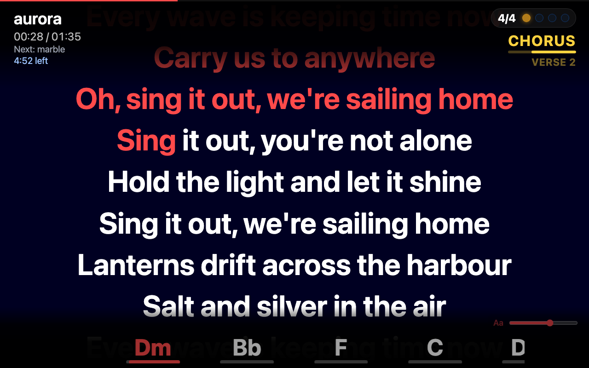
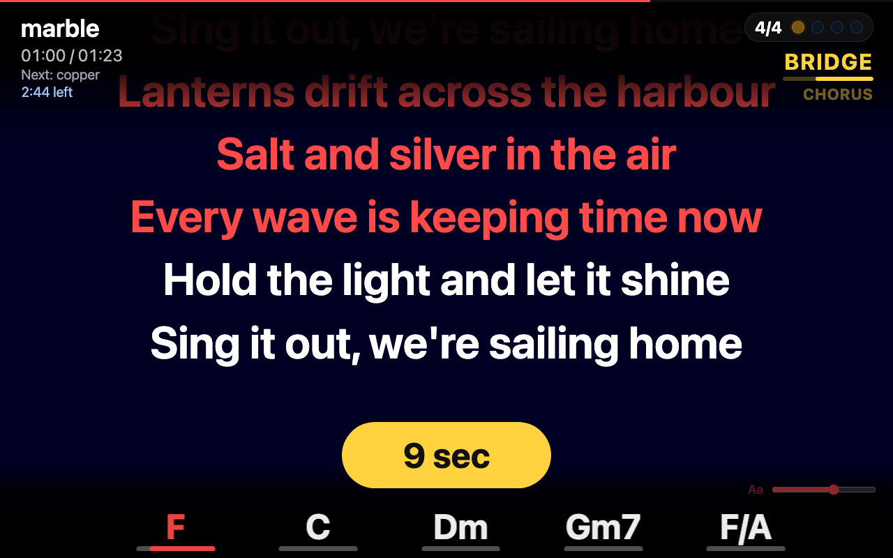
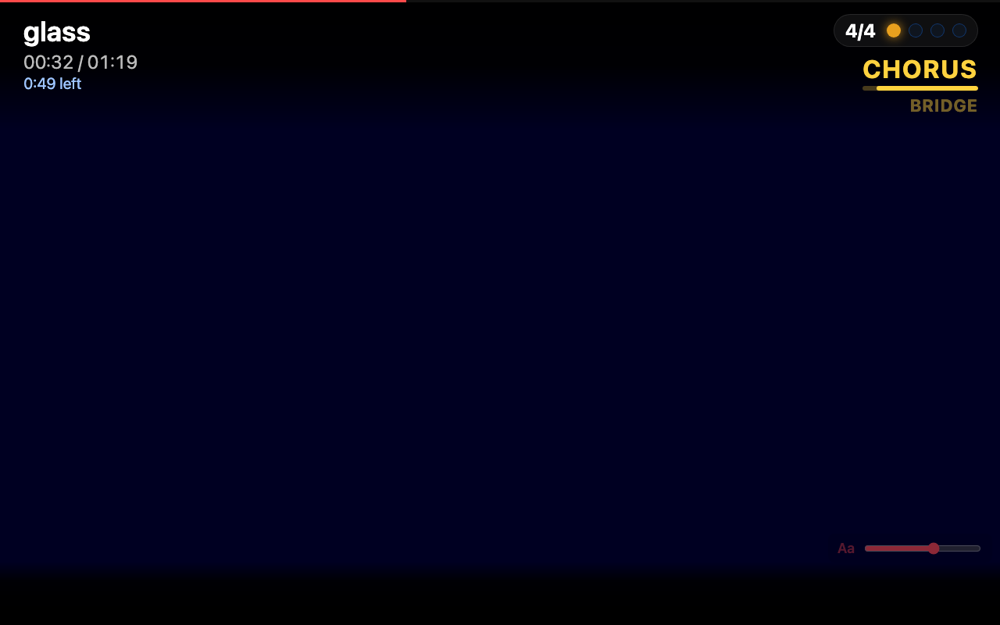
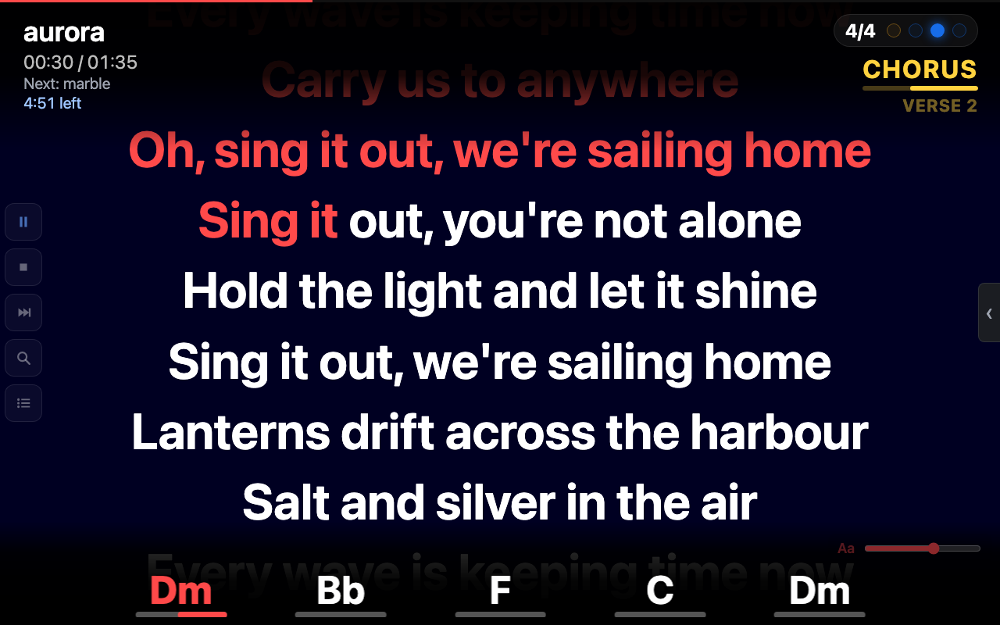
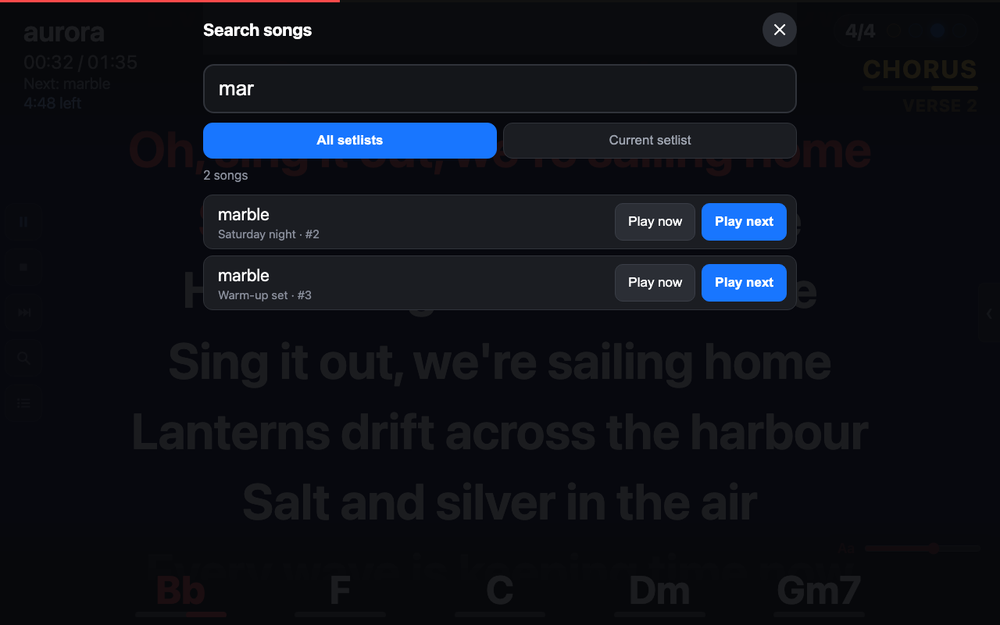
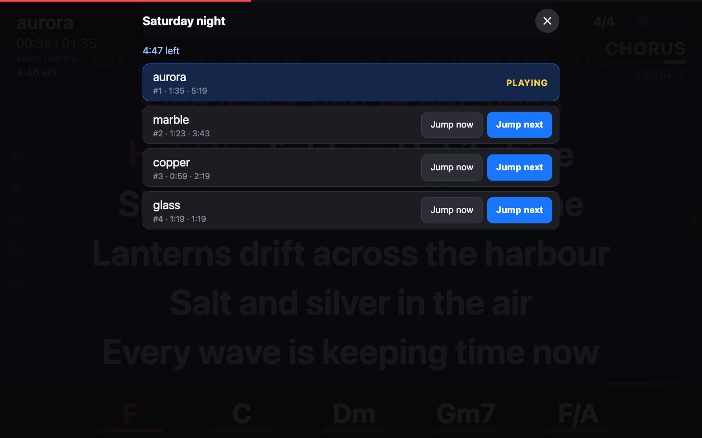

# The web page for the band

Merik has a small web server built in. Open it in any browser on the same network (iPad, Android tablet, phone, another laptop) and everybody in the band sees the lyrics, the chords, the sections and the beat of the song that is playing, live. With the control key, the same page also becomes a **remote control**.

## Opening the page

| Address | When |
|---|---|
| `http://merik.local` | The easy one. Merik announces itself on the network under this name (mDNS, also known as Bonjour). |
| `http://<IP address>` | The same page by IP address. **Settings, General** shows the full addresses. |

- Merik listens on **one** port: the normal web port **80**, so no port number is needed (`http://192.168.1.20`). Only if something else on the computer already uses port 80, Merik uses **8888** instead, and then only `:8888` works. Settings, General always shows the address that is in use.
- **If `merik.local` does not work** (the Wi-Fi network blocks mDNS, as some guest networks and hotspots do, or the device does not support it), use the IP address from Settings, General. The IP address works on every network where the devices can reach each other.
- `merik.local` works on iPhones, iPads, Macs and current Windows 10 and 11 versions. Some Android phones and tablets cannot resolve `.local` names in the browser; use the IP address there. (Tested here with a Mac; other devices not yet.)
- The computer and the tablet must be on the same network. A mobile hotspot, a router or the Wi-Fi of the venue all work, as long as devices may talk to each other (some guest Wi-Fi networks block that).
- On Windows, allow Merik on **private networks** when Windows asks.
- If Merik is not running, the page says so and connects again by itself as soon as it starts.

## What the band sees (view only)

Without a key the page is **view only**: nobody can change anything by accident.

  

- **Lyrics:** the current line is highlighted word by word, as sung. Karaoke, Midisoft and plain lyric events are all understood, and the text size has a slider (bottom right).
- **Chords:** the strip along the bottom shows the current chord and the next ones; the line under the chord runs out until the next chord. Slash chords (F/A) and bass notes are shown, and chords follow the transpose.
- **Sections:** at the top right, under the beat counter, the current part of the song (**Intro**, **Verse 1**, **Chorus**, ...) in yellow with a line that runs out, and below it the next one, smaller. They come from the markers in the MIDI file and slide up at a change.
- **Beat counter:** the time signature and a LED for every beat of the bar, lighting up on the beat (the first beat of the bar in amber).
- **Title area:** the song, the time, the next song and **how much time is left** in the setlist.

  

### The wait pill

When there is a long instrumental part before the next line is sung, a yellow pill counts down the seconds to the next lyric, so the singer knows when to come in.

  

### Songs without lyrics

Songs without lyrics or chords still show the title, the time, the sections and the beat counter.

  

## Advanced: control with the key

Set a key under **Settings, General** (*Web control key*; the default is `merik`) and add it to the address:

`http://merik.local/?key=merik`

Leave the key empty to make the page view-only for good. The key travels over your network without encryption, so use this on a network you trust.

With the key, **five buttons** appear on the left, and a handle on the right opens the **family mixer**:

  

| Button | What it does |
|---|---|
| **Play / Pause** | Starts or pauses the song |
| **Stop** | Stops and goes back to the start |
| **Next** | Goes to the next song of the setlist |
| **Search** (magnifier) | Opens the search screen (below) |
| **Setlist** (list icon) | Opens the setlist that is playing (below) |

The mixer has a fader and an on/off switch for every family, just like the main window.

### Search mode

Type at least three letters and pick a song from the current setlist or from **all setlists**. Tap **Play now** to start it at once, or **Play next** to start it after the current song. An inserted song does not move you in the setlist: when it is done the setlist continues where it was, and **Continue** takes you back to it.

  

### Setlist mode

The setlist that is playing, with the length of each song and the **time left until the end of the setlist** from there. **Jump now** goes to that song at once; **Jump next** goes there after the current song. The setlist then simply continues from that song. The cross at the top and a tap beside the list close the screen.

  

## Good to know

- The same page opens on this computer with the **Lyrics** button in Merik. Click it with <kbd>Cmd</kbd> (<kbd>Ctrl</kbd> or <kbd>Alt</kbd> on Windows) held down to open it with the key.
- Several devices can open the page at the same time.
